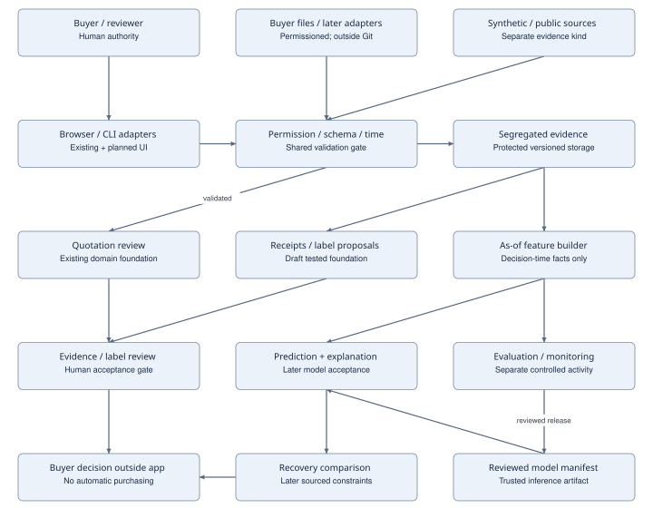
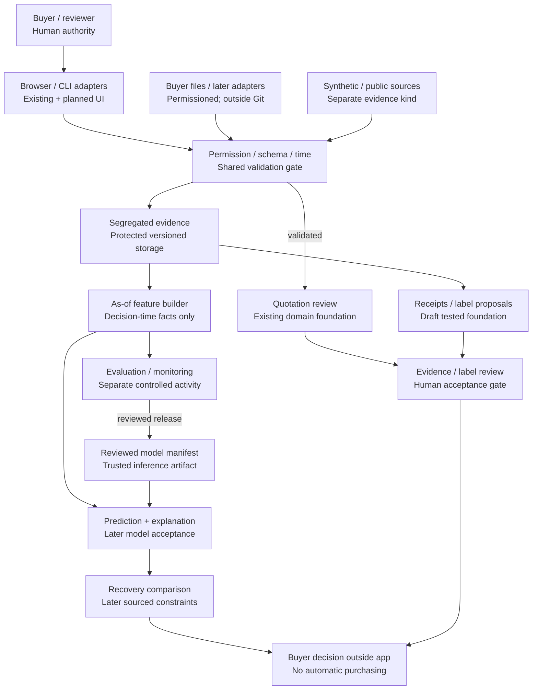
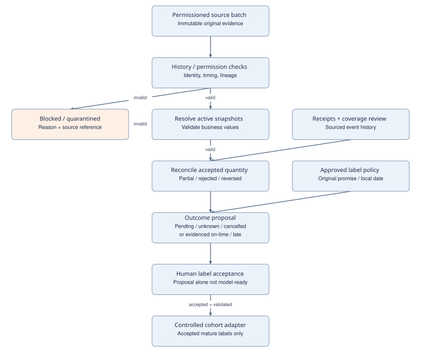
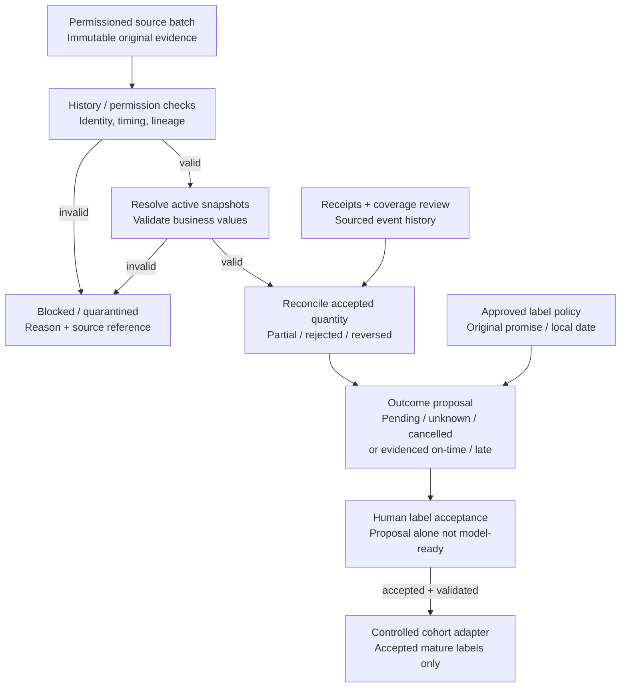
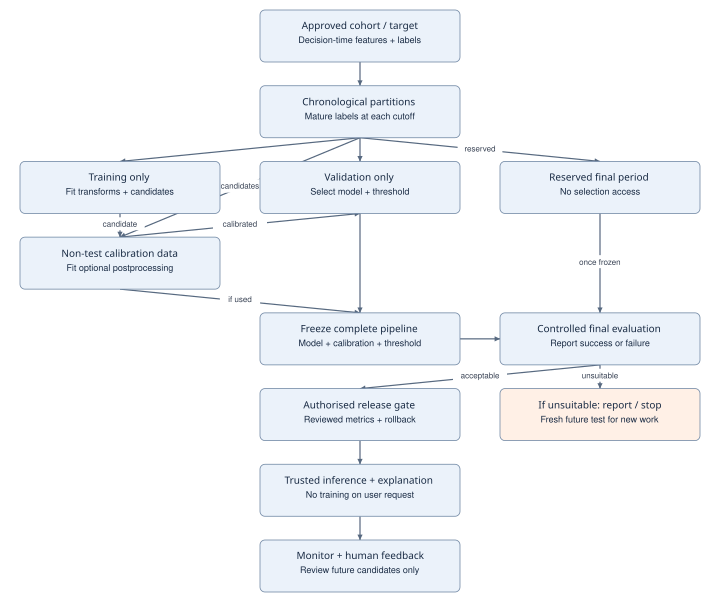
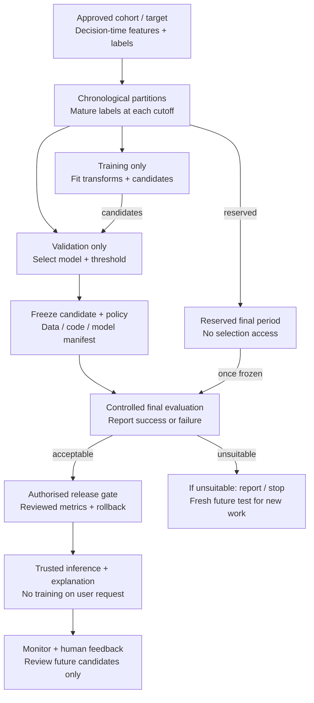

# Architecture views - SRS v0.3

Proposed logical design, 14 November 2026. These diagrams are not a claim of
deployed services or completed integrations. Shared local domain functions and
the existing browser/CLI remain the starting point. See [SRS](SRS.md) and
[roadmap](../ROADMAP.md) for requirement IDs, release gates and evidence status.

The SVG previews and Mermaid blocks below are generated from the same node/edge
definitions. Solid arrows indicate intended data/control flow, not network APIs.
Human approval and permission are required controls, not declarations the system can authenticate by itself.

## 1. System components and authority boundaries

Proposed logical architecture. Existing Python and offline browser foundations remain; adapters, review UI, monitoring and recovery are planned. Permissioned buyer files stay outside Git. Shared rules serve browser and CLI. Training is a separate activity; no component places purchases. Source-kind separation is required before downstream use.

## 2. Evidence intake, receipts and human label acceptance

Intended evidence workflow using the draft tested snapshot/receipt/label foundation. Lineage, provenance and timing are checked across all historical versions; business values are checked on active snapshots. Receipt coverage and an approved label policy gate any binary proposal. Human acceptance and a separate controlled adapter are required before an accepted outcome enters a learning cohort. Outcome labels never enter decision-time predictors.

## 3. Chronological evaluation and controlled model release

Proposed model governance. Freeze the target/cohort and decision-time features; fit transforms and models on training only. Select models and alert thresholds on validation only. Freeze the candidate before the final evaluation; an unsuitable result is reported honestly, and the same test is not recycled for tuning. Only an authorised release reaches inference. Drift or feedback cannot automatically promote a model. Calibration, if used, needs its own suitable partition and protocol.

## Reading the boundaries

- Raw buyer files and identity maps are protected outside Git; synthetic/public evidence remains segregated.
- Browser and CLI must call the same shared rules; an adapter cannot bypass validation.
- A proposed label is not human acceptance and is not model-ready.
- Model explanations describe model behaviour; recovery scenarios are conditional, not causal promises.
- Final-test results cannot feed the same selection loop. Fresh work needs a fresh evaluation protocol.
- Drift, subjective ratings and extracted document text do not establish ground truth.
- No arrow authorises an order, payment, supplier message or automatic model deployment.
